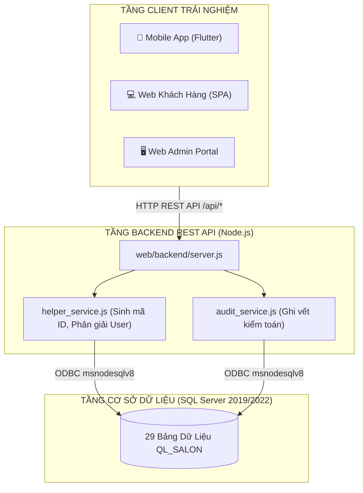

# CẨM NANG PHÂN TÍCH CHI TIẾT 14 LUỒNG NGHIỆP VỤ HỆ THỐNG OMNISALON
*(Tài Liệu Ôn Tập & Thuyết Minh Báo Cáo Bảo Vệ Đồ Án Trước Hội Đồng Chấm Điểm)*

---

## MỤC LỤC
1. [Tổng Quan Kiến Trúc Đa Nền Tảng (Omni-Channel Architecture)](#i-tổng-quan-kiến-trúc-đa-nền-tảng)
2. [Chi Tiết 14 Luồng Xử Lý Nghiệp Vụ](#ii-chi-tiết-14-luồng-xử-lý-nghiệp-vụ)
   - [Luồng 1: Xác Thực, Đăng Ký, Đăng Nhập & Phân Quyền (Auth & RBAC)](#luồng-1-xác-thực-đăng-ký-đăng-nhập--phân-quyền-auth--rbac)
   - [Luồng 2: Đặt Lịch Hẹn Trực Tuyến & Tiếp Nhận Tại Tiệm (Booking Flow)](#luồng-2-đặt-lịch-hẹn-trực-tuyến--tiếp-nhận-tại-tiệm-booking-flow)
   - [Luồng 3: Quản Lý & Tra Cứu Lịch Hẹn Của Tôi (Customer Bookings Flow)](#luồng-3-quản-lý--tra-cứu-lịch-hẹn-của-tôi-customer-bookings-flow)
   - [Luồng 4: Thanh Toán Tự Động VietQR & Webhook Ngân Hàng (Payment Automation)](#luồng-4-thanh-toán-tự-động-vietqr--webhook-ngân-hàng-payment-automation)
   - [Luồng 5: Quầy Thu Ngân POS & Hóa Đơn Bán Lẻ (POS & Billing Flow)](#luồng-5-quầy-thu-ngân-pos--hóa-đơn-bán-lẻ-pos--billing-flow)
   - [Luồng 6: Thương Mại Điện Tử & Giỏ Hàng Mỹ Phẩm (E-Commerce Flow)](#luồng-6-thương-mại-điện-tử--giỏ-hàng-mỹ-phẩm-e-commerce-flow)
   - [Luồng 7: Quản Lý Sản Phẩm, Kho Hàng & Xả Hạn FEFO (Inventory Flow)](#luồng-7-quản-lý-sản-phẩm-kho-hàng--xả-hạn-fefo-inventory-flow)
   - [Luồng 8: Quản Lý Nhà Cung Cấp Mỹ Phẩm & Dụng Cụ (Suppliers CRUD)](#luồng-8-quản-lý-nhà-cung-cấp-mỹ-phẩm--dụng-cụ-suppliers-crud)
   - [Luồng 9: Quản Trị Nhân Sự, Phân Ca & Tự Động Chuyển Lịch (Staff Flow)](#luồng-9-quản-trị-nhân-sự-phân-ca--tự-động-chuyển-lịch-staff-flow)
   - [Luồng 10: Quản Lý Chi Nhánh & Điều Phối Cơ Sở Admin (Branch Switcher Flow)](#luồng-10-quản-lý-chi-nhánh--điều-phối-cơ-sở-admin-branch-switcher-flow)
   - [Luồng 11: Trợ Lý AI & Studio Thử Kiểu Tóc Nam (AI Restyle Studio)](#luồng-11-trợ-lý-ai--studio-thử-kiểu-tóc-nam-ai-restyle-studio)
   - [Luồng 12: Thư Viện Tóc AI & Đặt Lịch Theo Mẫu (AI Hair Gallery)](#luồng-12-thư-viện-tóc-ai--đặt-lịch-theo-mẫu-ai-hair-gallery)
   - [Luồng 13: Khuyến Mãi & Giảm Giá Lũy Tiến (Promotions Flow)](#luồng-13-khuyến-mãi--giảm-giá-lũy-tiến-promotions-flow)
   - [Luồng 14: Báo Cáo Doanh Thu & Nhật Ký Kiểm Toán (Analytics & Audit)](#luồng-14-báo-cáo-doanh-thu--nhật-ký-kiểm-toán-analytics--audit)
3. [Bí Quyết Trả Lời Tự Tin & Ghi Điểm Tuyệt Đối Trước Hội Đồng](#iii-bí-quyết-trả-lời-tự-tin-trước-hội-đồng)

---

## I. TỔNG QUAN KIẾN TRÚC ĐA NỀN TẢNG

Hệ thống OmniSalon được thiết kế theo mô hình **Omni-channel Architecture**:
- **Mobile App (Flutter):** Tối ưu hóa trải nghiệm khách hàng trên điện thoại (Android, iOS) và Web view di động.
- **Web Khách Hàng (SPA):** Cổng thông tin khách hàng trên PC, cho phép đặt lịch, mua sắm và thử tóc AI trên màn hình lớn.
- **Web Admin Portal (Multi-Role):** Dành cho Quản trị viên, Quản lý chi nhánh, Thu ngân quầy.
- **Backend Node.js REST API:** Đóng vai trò **Single Source of Truth** (Nguồn chân lý duy nhất), điều phối logic, phân quyền bảo mật, tự động sinh mã ID tăng dần và giao tiếp trực tiếp với **Microsoft SQL Server (29 bảng dữ liệu)**.

---

## II. CHI TIẾT 14 LUỒNG XỬ LÝ NGHIỆP VỤ

---

### Luồng 1: Xác Thực, Đăng Ký, Đăng Nhập & Phân Quyền (Auth & RBAC)

#### 1. Tóm tắt 1 câu nghiệp vụ:
> *"Quản lý danh tính khách hàng đa nền tảng và kiểm soát bảo mật phân quyền 6 vai trò trực tiếp từ Server-side."*

#### 2. Quy trình xử lý kỹ thuật từng bước:
1. **Đăng ký tài khoản:**
   - Khách nhập Họ tên, SĐT, Mật khẩu trên App/Web.
   - Backend gọi `POST /api/auth/send-otp`: Sinh mã OTP ngẫu nhiên 6 số, lưu vào bảng `XacThucOTP` với thời hạn 5 phút.
   - Khách nhập OTP $\rightarrow$ Gọi `POST /api/auth/verify-otp`.
   - Nếu OTP hợp lệ: Khởi tạo hồ sơ trong bảng `KhachHang` và tài khoản đăng nhập trong `TaiKhoan` với `VaiTro = N'Khách Hàng'`.
2. **Đăng nhập:**
   - Hỗ trợ 2 phương thức: Đăng nhập mật khẩu truyền thống HOẶC Đăng nhập nhanh không cần mật khẩu bằng OTP.
   - Server xác thực thông tin, trả về token phiên làm việc kèm `role` và `branchId`.
3. **Phân quyền Role-Based Access Control (RBAC):**
   - Được chặn nghiêm ngặt ở tầng API backend (`accounts.routes.js`, `staff.routes.js`):
     - `SUPER_ADMIN`: Toàn quyền 20 chi nhánh.
     - `BRANCH_MANAGER`: Chỉ được thao tác trên chi nhánh mình phụ trách (không được tự đổi chi nhánh của nhân viên, không được tự thăng cấp thợ lên Quản lý).
     - `CASHIER`: Quyền thao tác quầy thu ngân POS, tạo hóa đơn.
     - `STYLIST`: Xem lịch hẹn của mình.
     - `CUSTOMER`: Chỉ xem thông tin, lịch hẹn, đơn hàng của chính mình.
     - `SYSTEM`: Tự động hóa tác vụ ngầm.

#### 3. Bản đồ mã nguồn (Code Mapping):
- **Mobile App:** [login_page.dart](file:///c:/Users/dinhd/Downloads/OmniSalon/mobile/lib/pages/auth/login_page.dart), [register_page.dart](file:///c:/Users/dinhd/Downloads/OmniSalon/mobile/lib/pages/auth/register_page.dart), [otp_verification_page.dart](file:///c:/Users/dinhd/Downloads/OmniSalon/mobile/lib/pages/auth/otp_verification_page.dart)
- **Web Customer:** [auth.js](file:///c:/Users/dinhd/Downloads/OmniSalon/web/frontend/js/core/auth.js) (`AuthEngine`)
- **Web Admin:** [admin-audit.js](file:///c:/Users/dinhd/Downloads/OmniSalon/web/frontend/js/modules/admin/audit/admin-audit.js) (Tab *Tài Khoản & Phân Quyền*)
- **Backend API:** [auth.routes.js](file:///c:/Users/dinhd/Downloads/OmniSalon/web/backend/routes/auth/auth.routes.js), [accounts.routes.js](file:///c:/Users/dinhd/Downloads/OmniSalon/web/backend/routes/auth/accounts.routes.js)
- **CSDL SQL:** Bảng `TaiKhoan`, `KhachHang`, `XacThucOTP`.

#### 4. Điểm sáng ghi điểm & Câu hỏi hội đồng:
- 🎯 **Điểm sáng:** Phân quyền thực hiện ở **Server-side (Backend)** chứ không chỉ ẩn nút ở Frontend. Cố tình gửi request vượt quyền sẽ bị trả về mã `HTTP 403 Forbidden`.
- ❓ **Hội đồng hỏi:** *"Nếu khách nhập sai OTP nhiều lần thì sao?"*  
  $\rightarrow$ **Trả lời:** Bảng `XacThucOTP` có cơ chế kiểm tra thời gian `HetHanLuc`, mã chỉ tồn tại 5 phút và tự hủy nếu quá hạn.

---

### Luồng 2: Đặt Lịch Hẹn Trực Tuyến & Tiếp Nhận Tại Tiệm (Booking Flow)

#### 1. Tóm tắt 1 câu nghiệp vụ:
> *"Quy trình khép kín giúp khách chọn thợ, chọn giờ không lo trùng lịch (Overbooking), và hỗ trợ tiếp nhận khách vãng lai tại quầy."*

#### 2. Quy trình xử lý kỹ thuật từng bước:
1. **Tra cứu khung giờ trống (`GET /api/bookings/available-slots`):**
   - Client gửi ngày (`date`) và mã thợ (`stylistId`).
   - Server quét danh sách 12 khung giờ cố định (`08:30` đến `20:30`).
   - Loại trừ các khung giờ **đã trôi qua trong quá khứ** so với giờ hiện tại của hệ thống.
   - Loại trừ các khung giờ thợ đó **đã có hẹn** trong bảng `LichHen` (`TrangThai <> N'Đã hủy'`).
   - Trả về danh sách trạng thái `available: true/false` cho từng khung giờ.
2. **Tạo lịch hẹn (`POST /api/bookings`):**
   - Hàm `resolveOrCreateCustomer`: Kiểm tra SĐT khách hàng. Nếu đã có trong `KhachHang` thì liên kết `MaKhachHang`; nếu là khách mới thì tự động tạo bản ghi mới.
   - Hàm `generateNextBookingId`: Tự động sinh mã tăng dần `LH01`, `LH02`,..., `LH24` từ SQL Server.
   - Lưu thông tin vào bảng `LichHen` (Mã, Khách, Thợ, Chi nhánh, Ngày, Giờ bắt đầu, Giờ kết thúc, Trạng thái khởi tạo `Đã xác nhận` hoặc `Chờ vào ghế`).
   - Lưu từng dịch vụ thành phần vào bảng `ChiTietLichHen`.
   - Tự động tạo bản ghi vào bảng `ThongBao` cho cả khách và thợ.
3. **Tiếp nhận khách vãng lai (Walk-in):**
   - Lễ tân tạo lịch tại quầy với cờ `isWalkin = true`, bỏ qua kiểm tra giờ quá khứ, đưa khách thẳng vào trạng thái `Chờ vào ghế` hoặc `Đang phục vụ`.
4. **Tự động hủy lịch trễ hạn:**
   - Endpoint `POST /api/bookings/auto-cancel-overdue` quét các lịch hẹn quá 12h đêm ngày hẹn chưa thực hiện $\rightarrow$ Tự động chuyển `TrangThai = N'Đã hủy'`.

#### 3. Bản đồ mã nguồn:
- **Mobile App:** [booking_page.dart](file:///c:/Users/dinhd/Downloads/OmniSalon/mobile/lib/pages/user/booking_page.dart)
- **Web Customer:** [booking-page.js](file:///c:/Users/dinhd/Downloads/OmniSalon/web/frontend/pages/customer/booking-page.js)
- **Web Admin:** [admin-bookings.js](file:///c:/Users/dinhd/Downloads/OmniSalon/web/frontend/js/modules/admin/booking/admin-bookings.js)
- **Backend API:** [bookings.routes.js](file:///c:/Users/dinhd/Downloads/OmniSalon/web/backend/routes/bookings/bookings.routes.js)
- **CSDL SQL:** Bảng `LichHen`, `ChiTietLichHen`, `ThongBao`.

#### 4. Điểm sáng ghi điểm & Câu hỏi hội đồng:
- 🎯 **Điểm sáng:** Giải quyết triệt để lỗi xung đột mã giữa Mobile và Web bằng cơ chế **Single Source of Truth** sinh mã tuần tự tại Backend.
- ❓ **Hội đồng hỏi:** *"Làm sao tránh trường hợp khách đặt lịch vào thời gian trong quá khứ?"*  
  $\rightarrow$ **Trả lời:** Backend so sánh `date < todayIso` hoặc `(date == todayIso && slotMinutes < currentMinutes - 5)` để từ chối ngay với mã lỗi `HTTP 400 Bad Request`.

---

### Luồng 3: Quản Lý & Tra Cứu Lịch Hẹn Của Tôi (Customer Bookings Flow)

#### 1. Tóm tắt 1 câu nghiệp vụ:
> *"Không gian riêng tư cho phép khách hàng đã đăng nhập theo dõi tiến trình lịch hẹn và chủ động hủy lịch khi có việc bận."*

#### 2. Quy trình xử lý kỹ thuật từng bước:
1. **Kiểm tra đăng nhập:** Khách hàng bắt buộc phải đăng nhập tài khoản (`AuthService.currentUser != null`). Nếu chưa đăng nhập, hệ thống hiển thị trạng thái yêu cầu đăng nhập.
2. **Kéo dữ liệu:** Client lấy SĐT hoặc User ID của tài khoản gọi API `/api/bookings/lookup?q=...` hoặc `/api/bookings`.
3. **Phân loại hiển thị:** Phân tách lịch hẹn thành các Tab: *Tất cả*, *Đang chờ (Active)*, *Hoàn thành (Completed)*, *Đã hủy (Cancelled)*.
4. **Hủy lịch hẹn:** Khách bấm "Hủy lịch" $\rightarrow$ Nhập lý do $\rightarrow$ Gọi `PATCH /api/bookings/:id/cancel` $\rightarrow$ Server cập nhật `LichHen.TrangThai = N'Đã hủy'` kèm `LyDoHuy`, giải phóng khung giờ trống của thợ.

#### 3. Bản đồ mã nguồn:
- **Mobile App:** [my_bookings_page.dart](file:///c:/Users/dinhd/Downloads/OmniSalon/mobile/lib/pages/user/my_bookings_page.dart)
- **Web Customer:** [profile-page.js](file:///c:/Users/dinhd/Downloads/OmniSalon/web/frontend/pages/customer/profile-page.js) (Tab *Lịch Hẹn Cắt Tóc*)
- **Backend API:** [bookings.routes.js](file:///c:/Users/dinhd/Downloads/OmniSalon/web/backend/routes/bookings/bookings.routes.js) (`/api/bookings/*`)
- **CSDL SQL:** Bảng `LichHen`, `ChiTietLichHen`, `KhachHang`.

---

### Luồng 4: Thanh Toán Tự Động VietQR & Webhook Ngân Hàng (Payment Automation)

#### 1. Tóm tắt 1 câu nghiệp vụ:
> *"Tự động hóa đối soát thanh toán chuyển khoản bằng mã QR động chuẩn VietQR kết hợp Webhook biến động số dư ngân hàng."*

#### 2. Quy trình xử lý kỹ thuật từng bước:
1. Khi khách chọn phương thức thanh toán Chuyển khoản QR:
2. Màn hình `vietqr_payment_page.dart` tạo mã VietQR động với các tham số: STK MBBank của salon, Tên chủ tài khoản, Số tiền chính xác và Nội dung chuyển khoản chứa mã đơn hàng (`DHxx` hoặc `LHxx`).
3. Khởi động đồng hồ đếm ngược 15 phút (`900 giây`).
4. Client liên tục thăm dò trạng thái qua `GET /api/payments/status?code=...` mỗi 3 giây.
5. Khi khách chuyển khoản thành công, cổng PayOS hoặc Casso bắn Webhook về `POST /api/payment/payos-webhook` $\rightarrow$ Backend kiểm tra khớp nội dung và số tiền $\rightarrow$ Cập nhật trạng thái `DonHang.TrangThai = N'Đã thanh toán'` và lưu vào bảng `ThanhToan` $\rightarrow$ Client nhận tín hiệu tự chuyển sang màn hình [payment_success_page.dart](file:///c:/Users/dinhd/Downloads/OmniSalon/mobile/lib/pages/user/payment_success_page.dart).

#### 3. Bản đồ mã nguồn:
- **Mobile App:** [vietqr_payment_page.dart](file:///c:/Users/dinhd/Downloads/OmniSalon/mobile/lib/pages/user/vietqr_payment_page.dart), [payment_success_page.dart](file:///c:/Users/dinhd/Downloads/OmniSalon/mobile/lib/pages/user/payment_success_page.dart)
- **Backend API:** [payment.routes.js](file:///c:/Users/dinhd/Downloads/OmniSalon/web/backend/routes/payment/payment.routes.js), `payment.controller.js`, `payment_automation_service.js`
- **CSDL SQL:** Bảng `ThanhToan`, `DonHang`, `HoaDon`.

#### 4. Điểm sáng ghi điểm & Câu hỏi hội đồng:
- 🎯 **Điểm sáng:** Tiết kiệm thời gian cho quầy thu ngân, khách thanh toán xong là phần mềm tự nhận diện, không cần nhân viên chụp màn hình chuyển khoản đối soát bằng mắt.

---

### Luồng 5: Quầy Thu Ngân POS & Hóa Đơn Bán Lẻ (POS & Billing Flow)

#### 1. Tóm tắt 1 câu nghiệp vụ:
> *"Nghiệp vụ cốt lõi tại quầy thu ngân: Cho phép gộp dịch vụ cắt tóc và mỹ phẩm bán lẻ vào cùng một hóa đơn, tự động trừ kho FEFO."*

#### 2. Quy trình xử lý kỹ thuật từng bước:
1. Thu ngân chọn lịch hẹn cần thanh toán trên màn hình `admin-pos.js`, có thể chọn thêm các mỹ phẩm khách mua thêm tại quầy.
2. Gửi request `POST /api/pos/checkout`.
3. Sinh mã hóa đơn tăng dần `HD01`, `HD02`... lưu vào bảng `HoaDon`.
4. Chi tiết dịch vụ làm tóc lưu vào bảng `ChiTietHoaDon_DichVu`.
5. **Trừ kho mỹ phẩm FEFO:** Gọi Stored Procedure `sp_ThemChiTietHoaDonSanPham` hoặc chạy truy vấn tìm lô hàng có **hạn sử dụng gần nhất còn tồn tại chi nhánh đó** trong bảng `ChiTietPhieuNhap` để trừ số lượng (`SoLuongConLai = SoLuongConLai - Qty`).
6. Lưu thông tin thanh toán vào bảng `ThanhToan` (Tiền mặt, Quẹt thẻ, Chuyển khoản QR).
7. Tự động chuyển trạng thái lịch hẹn tương ứng trong `LichHen` sang `Hoàn thành`.

#### 3. Bản đồ mã nguồn:
- **Web Admin:** [admin-pos.js](file:///c:/Users/dinhd/Downloads/OmniSalon/web/frontend/js/modules/admin/pos/admin-pos.js)
- **Backend API:** [pos.routes.js](file:///c:/Users/dinhd/Downloads/OmniSalon/web/backend/routes/store/pos.routes.js)
- **CSDL SQL:** Bảng `HoaDon`, `ChiTietHoaDon_DichVu`, `ChiTietHoaDon_SanPham`, `ThanhToan`, `TonKho`, `ChiTietPhieuNhap`.

#### 4. Điểm sáng ghi điểm & Câu hỏi hội đồng:
- 🎯 **Điểm sáng:** Ràng buộc toàn vẹn `CK_HoaDon_Nguon` trong SQL Server: Một hóa đơn bắt buộc phải có nguồn thu (hoặc `MaLichHen`, hoặc `MaDonHang`), không được phép để trống cả hai.
- ❓ **Hội đồng hỏi:** *"Nếu khách đổi ý trả lại hàng thì xử lý thế nào?"*  
  $\rightarrow$ **Trả lời:** Hệ thống có API `POST /api/invoices/:id/refund` và `/cancel` cho phép hủy hóa đơn, hoàn tiền và **tự động hoàn trả lại số lượng tồn kho** cho lô hàng tương ứng.

---

### Luồng 6: Thương Mại Điện Tử & Giỏ Hàng Mỹ Phẩm (E-Commerce Flow)

#### 1. Tóm tắt 1 câu nghiệp vụ:
> *"Kênh bán lẻ mỹ phẩm online phục vụ khách hàng mua sáp vuốt tóc, dầu gội giao hàng tận nhà."*

#### 2. Quy trình xử lý kỹ thuật từng bước:
1. Khách hàng xem danh mục mỹ phẩm trên App hoặc Web. Bộ lọc "Đang giảm giá" lọc chính xác các sản phẩm có `discountPercent > 0` và xếp giảm từ cao xuống thấp (70% $\rightarrow$ 10%).
2. Khách thêm sản phẩm vào giỏ hàng `cart_page.dart`.
3. Bấm đặt hàng $\rightarrow$ Gửi request `POST /api/orders` kèm địa chỉ nhận hàng và danh sách sản phẩm.
4. Server sinh mã tăng dần `DH01, DH02...`, lưu vào bảng `DonHang` và `ChiTietDonHang`.
5. Quản trị viên duyệt đơn qua các trạng thái: `Chờ xác nhận` $\rightarrow$ `Đang xử lý` $\rightarrow$ `Đang giao` $\rightarrow$ `Đã giao`.
6. Khách hàng theo dõi lộ trình đơn hàng trong tab *Đơn Hàng Mỹ Phẩm (DH)*.

#### 3. Bản đồ mã nguồn:
- **Mobile App:** [shop_page.dart](file:///c:/Users/dinhd/Downloads/OmniSalon/mobile/lib/pages/user/shop_page.dart), [cart_page.dart](file:///c:/Users/dinhd/Downloads/OmniSalon/mobile/lib/pages/user/cart_page.dart), [my_bookings_page.dart](file:///c:/Users/dinhd/Downloads/OmniSalon/mobile/lib/pages/user/my_bookings_page.dart)
- **Web Customer:** [shop-page.js](file:///c:/Users/dinhd/Downloads/OmniSalon/web/frontend/pages/customer/shop-page.js), [cart-page.js](file:///c:/Users/dinhd/Downloads/OmniSalon/web/frontend/pages/customer/cart-page.js)
- **Web Admin:** [admin-audit.js](file:///c:/Users/dinhd/Downloads/OmniSalon/web/frontend/js/modules/admin/audit/admin-audit.js) (Tab *Đơn Hàng & Thanh Toán*)
- **Backend API:** [products.routes.js](file:///c:/Users/dinhd/Downloads/OmniSalon/web/backend/routes/store/products.routes.js), [orders.routes.js](file:///c:/Users/dinhd/Downloads/OmniSalon/web/backend/routes/store/orders.routes.js)
- **CSDL SQL:** Bảng `SanPham`, `DonHang`, `ChiTietDonHang`.

---

### Luồng 7: Quản Lý Sản Phẩm, Kho Hàng & Xả Hạn FEFO (Inventory Flow)

#### 1. Tóm tắt 1 câu nghiệp vụ:
> *"Quản trị kho chuỗi 20 chi nhánh và tự động tính toán giá xả hàng cận date theo chuẩn FEFO (First Expired First Out)."*

#### 2. Quy trình xử lý kỹ thuật từng bước:
1. **Khởi tạo sản phẩm mới (`POST /api/products`):**
   - Lưu thông tin sản phẩm vào bảng `SanPham`.
   - **Tự động kích hoạt tồn kho đa chi nhánh:** Tự động sinh 20 bản ghi vào bảng `TonKho` cho 20 chi nhánh (`CN01` $\rightarrow$ `CN20`) với số lượng ban đầu bằng 0 và mức cảnh báo là 5.
2. **Nhập kho theo Lô (`PhieuNhapKho` & `ChiTietPhieuNhap`):**
   - Quản lý tạo phiếu nhập kho kèm `SoLo`, `HanSuDung`, `SoLuongNhap`, `GiaNhap`.
   - Cơ chế duyệt 2 bước: Quản lý bấm "Duyệt" (`POST /api/inventory/receipts/:id/approve`) thì tồn kho mới chính thức được cộng dồn vào `TonKho`.
3. **Quy tắc FEFO (`QuyTacGiamGiaTheoHan`):**
   - Server tính số ngày còn lại đến hạn dùng (`daysLeft`):
     - $\le 30$ ngày: Giảm **70%** (Cận hạn gấp - Flash sale).
     - $31 - 90$ ngày: Giảm **40%** (Cận hạn).
     - $91 - 180$ ngày: Giảm **20%** (Xả kho nhẹ).
     - $> 180$ ngày: Giảm **0%** (Hạn an toàn - Bán đúng giá niêm yết chuẩn).
4. **Cảnh báo hàng sắp hết:** API `/api/inventory/low-stock` quét các sản phẩm có `SoLuongTon <= MucCanhBao` để báo động nhập hàng.

#### 3. Bản đồ mã nguồn:
- **Web Admin:** [admin-inventory.js](file:///c:/Users/dinhd/Downloads/OmniSalon/web/frontend/js/modules/admin/inventory/admin-inventory.js)
- **Backend API:** [products.routes.js](file:///c:/Users/dinhd/Downloads/OmniSalon/web/backend/routes/store/products.routes.js), [inventory.routes.js](file:///c:/Users/dinhd/Downloads/OmniSalon/web/backend/routes/store/inventory.routes.js)
- **CSDL SQL:** Bảng `SanPham`, `TonKho`, `PhieuNhapKho`, `ChiTietPhieuNhap`, `QuyTacGiamGiaTheoHan`.

#### 4. Điểm sáng ghi điểm & Câu hỏi hội đồng:
- 🎯 **Điểm sáng:** Ứng dụng nghiệp vụ bán lẻ thực tế (FEFO), giải quyết bài toán hàng cận date bị vứt bỏ lãng phí.

---

### Luồng 8: Quản Lý Nhà Cung Cấp Mỹ Phẩm & Dụng Cụ (Suppliers CRUD)

#### 1. Tóm tắt 1 câu nghiệp vụ:
> *"Quản lý danh bạ đối tác cung ứng mỹ phẩm và thiết bị salon liên kết trực tiếp với phiếu nhập kho."*

#### 2. Quy trình xử lý kỹ thuật từng bước:
1. Quản trị viên thực hiện các thao tác thêm, sửa, xóa đối tác qua `/api/suppliers`.
2. Thông tin đối tác (Tên nhà cung cấp, Hotline, Email, Địa chỉ, Mã số thuế) lưu vào bảng `NhaCungCap`.
3. Khi tạo phiếu nhập kho `PhieuNhapKho`, trường `MaNhaCungCap` là khóa ngoại bắt buộc để quản lý nguồn gốc xuất xứ hàng hóa.

#### 3. Bản đồ mã nguồn:
- **Web Admin:** [admin-inventory.js](file:///c:/Users/dinhd/Downloads/OmniSalon/web/frontend/js/modules/admin/inventory/admin-inventory.js)
- **Backend API:** [inventory.routes.js](file:///c:/Users/dinhd/Downloads/OmniSalon/web/backend/routes/store/inventory.routes.js) (`/api/suppliers/*`)
- **CSDL SQL:** Bảng `NhaCungCap`.

---

### Luồng 9: Quản Trị Nhân Sự, Phân Ca & Tự Động Chuyển Lịch (Staff Flow)

#### 1. Tóm tắt 1 câu nghiệp vụ:
> *"Quản lý đội ngũ nhân sự, phân ca làm việc và tự động chuyển giao lịch hẹn khi thợ nghỉ việc đột xuất."*

#### 2. Quy trình xử lý kỹ thuật từng bước:
1. **Thêm nhân viên mới (`POST /api/stylists`):**
   - Chỉ `SUPER_ADMIN` mới được chỉ định Quản lý chi nhánh. Quản lý chi nhánh chỉ được thêm thợ vào chi nhánh mình.
   - Lưu vào bảng `NhanVien`.
   - **Tự động cấp tài khoản đăng nhập (`TaiKhoan`):** Mã `TK_NVxx`, username là SĐT hoặc mã NV, mật khẩu mặc định `nv123`.
2. **Phân ca làm việc:** Quản lý xếp ca sáng/chiều/tối vào bảng `CaLamViec` qua API `/api/shifts`.
3. **Cho thợ nghỉ việc (`DELETE /api/stylists/:id`):**
   - Cập nhật `NhanVien.TrangThai = N'Đã nghỉ việc'` và khóa tài khoản trong `TaiKhoan`.
   - **Thuật toán Smart Reassignment:** Tự động quét toàn bộ lịch hẹn sắp tới của thợ này (`Chờ xác nhận`, `Đã xác nhận`) và tự động chuyển giao sang một thợ khác đang làm việc cùng cơ sở.

#### 3. Bản đồ mã nguồn:
- **Web Admin:** [admin-stylists.js](file:///c:/Users/dinhd/Downloads/OmniSalon/web/frontend/js/modules/admin/staff/admin-stylists.js)
- **Mobile & Web Customer:** [stylists_page.dart](file:///c:/Users/dinhd/Downloads/OmniSalon/mobile/lib/pages/user/stylists_page.dart), [stylists-page.js](file:///c:/Users/dinhd/Downloads/OmniSalon/web/frontend/pages/customer/stylists-page.js)
- **Backend API:** [staff.routes.js](file:///c:/Users/dinhd/Downloads/OmniSalon/web/backend/routes/salon/staff.routes.js)
- **CSDL SQL:** Bảng `NhanVien`, `TaiKhoan`, `CaLamViec`, `DanhGia`.

#### 4. Điểm sáng ghi điểm & Câu hỏi hội đồng:
- 🎯 **Điểm sáng:** Cơ chế tự động chuyển giao lịch hẹn giúp trải nghiệm khách hàng không bị đổ vỡ khi salon có biến động nhân sự.

---

### Luồng 10: Quản Lý Chi Nhánh & Điều Phối Cơ Sở Admin (Branch Switcher Flow)

#### 1. Tóm tắt 1 câu nghiệp vụ:
> *"Mô hình quản trị tập trung (Centralized Management) hỗ trợ mở rộng và vận hành chuỗi 20 chi nhánh salon."*

#### 2. Quy trình xử lý kỹ thuật từng bước:
1. Khách xem danh sách 20 chi nhánh, hình ảnh, địa chỉ, giờ mở/đóng cửa và hotline trên [branches_page.dart](file:///c:/Users/dinhd/Downloads/OmniSalon/mobile/lib/pages/user/branches_page.dart) và [branches-page.js](file:///c:/Users/dinhd/Downloads/OmniSalon/web/frontend/pages/customer/branches-page.js).
2. Trên Web Admin ([admin-shell.js](file:///c:/Users/dinhd/Downloads/OmniSalon/web/frontend/js/modules/admin/layout/admin-shell.js)), có thanh điều phối cơ sở:
   - SuperAdmin chọn "Toàn hệ thống cơ sở" $\rightarrow$ Xem báo cáo gộp 20 chi nhánh.
   - SuperAdmin chọn `CN01` (Quận 1) $\rightarrow$ Toàn bộ dữ liệu Lịch hẹn, Thu ngân POS, Tồn kho, Nhân sự lập tức lọc độc quyền theo cơ sở Quận 1.

#### 3. Bản đồ mã nguồn:
- **Mobile App:** [branches_page.dart](file:///c:/Users/dinhd/Downloads/OmniSalon/mobile/lib/pages/user/branches_page.dart)
- **Web Customer:** [branches-page.js](file:///c:/Users/dinhd/Downloads/OmniSalon/web/frontend/pages/customer/branches-page.js)
- **Web Admin:** [admin-branches.js](file:///c:/Users/dinhd/Downloads/OmniSalon/web/frontend/js/modules/admin/branches/admin-branches.js), [admin-shell.js](file:///c:/Users/dinhd/Downloads/OmniSalon/web/frontend/js/modules/admin/layout/admin-shell.js)
- **Backend API:** [branches.routes.js](file:///c:/Users/dinhd/Downloads/OmniSalon/web/backend/routes/salon/branches.routes.js)
- **CSDL SQL:** Bảng `ChiNhanh`.

---

### Luồng 11: Trợ Lý AI & Studio Thử Kiểu Tóc Nam (AI Restyle Studio)

#### 1. Tóm tắt 1 câu nghiệp vụ:
> *"Tích hợp AI Computer Vision & Inpainting giúp khách hàng nhìn thấy trước kiểu tóc mới trên khuôn mặt thật của mình."*

#### 2. Quy trình xử lý kỹ thuật từng bước:
1. Khách chụp ảnh chân dung hoặc tải ảnh từ máy lên.
2. `POST /api/ai/analyze-face`: AI phân tích góc mặt và tỉ lệ khuôn mặt (Tròn, Vuông, Trái xoan, Kim cương).
3. `POST /api/ai/segment-hair`: Tách lớp tóc cũ khỏi vùng da đầu và khuôn mặt.
4. `POST /api/ai/restyle-hair`: Áp dụng mô hình AI Diffusion Inpainting vẽ các kiểu tóc thịnh hành (Buzz cut, Pompadour, Undercut, Side part) khớp với góc mặt.
5. `POST /api/ai/ask-barber`: Trợ lý Barber AI tư vấn cách vuốt sáp và chăm sóc tóc.

#### 3. Bản đồ mã nguồn:
- **Mobile App:** [ai_studio_page.dart](file:///c:/Users/dinhd/Downloads/OmniSalon/mobile/lib/pages/user/ai_studio_page.dart)
- **Web Customer:** [ai-studio-page.js](file:///c:/Users/dinhd/Downloads/OmniSalon/web/frontend/pages/customer/ai-studio-page.js)
- **Backend API:** [ai.routes.js](file:///c:/Users/dinhd/Downloads/OmniSalon/web/backend/routes/ai/ai.routes.js)

---

### Luồng 12: Thư Viện Tóc AI & Đặt Lịch Theo Mẫu (AI Hair Gallery)

#### 1. Tóm tắt 1 câu nghiệp vụ:
> *"Cầu nối giữa trải nghiệm công nghệ AI và dịch vụ thực tế tại salon: Lưu mẫu tóc ưa thích và bấm 1 chạm để đặt lịch."*

#### 2. Quy trình xử lý kỹ thuật từng bước:
1. Trong màn hình hồ sơ cá nhân của khách ([profile-page.js](file:///c:/Users/dinhd/Downloads/OmniSalon/web/frontend/pages/customer/profile-page.js)), có tab **Thư Viện Tóc AI** hiển thị danh sách các ảnh tóc khách đã tạo thành công.
2. Khách có thể tải ảnh về hoặc bấm nút **"Đặt lịch cắt kiểu này ngay"**.
3. Hệ thống tự động chuyển hướng sang màn hình Đặt lịch, tự động đính kèm hình ảnh kiểu tóc mẫu vào ghi chú để thợ cắt nhìn vào làm theo.

#### 3. Bản đồ mã nguồn:
- **Web Customer:** [profile-page.js](file:///c:/Users/dinhd/Downloads/OmniSalon/web/frontend/pages/customer/profile-page.js) (Hàm `renderGalleryTab`)
- **Mobile App:** Lưu cache trạng thái và thư viện cục bộ trên thiết bị.

---

### Luồng 13: Khuyến Mãi & Giảm Giá Lũy Tiến (Promotions Flow)

#### 1. Tóm tắt 1 câu nghiệp vụ:
> *"Quản lý chiến dịch khuyến mãi toàn chuỗi và thuật toán tính giảm giá lũy tiến chuẩn tài chính."*

#### 2. Quy trình xử lý kỹ thuật từng bước:
1. Quản lý tạo khuyến mãi trong bảng `KhuyenMai`, gán cho dịch vụ cụ thể (`KhuyenMai_DichVu`) hoặc sản phẩm (`KhuyenMai_SanPham`).
2. **Cơ chế Giảm Giá Lũy Tiến:** Nếu một sản phẩm vừa cận date (giảm 20%) vừa có khuyến mãi tháng (giảm 10%), hệ thống tính toán:
   $$\text{Giá Cuối} = \text{Giá Gốc} \times (1 - 0.20) \times (1 - 0.10) \rightarrow \text{Mức giảm thực tế là } 28\%$$
   Tránh được lỗi tài chính nghiêm trọng khi cộng dồn số học ($20\% + 90\% = 110\%$ gây âm tiền).

#### 3. Bản đồ mã nguồn:
- **Web Admin:** [admin-promotions.js](file:///c:/Users/dinhd/Downloads/OmniSalon/web/frontend/js/modules/admin/promotions/admin-promotions.js)
- **Backend API:** [promotions.routes.js](file:///c:/Users/dinhd/Downloads/OmniSalon/web/backend/routes/marketing/promotions.routes.js)
- **CSDL SQL:** Bảng `KhuyenMai`, `KhuyenMai_DichVu`, `KhuyenMai_SanPham`.

---

### Luồng 14: Báo Cáo Doanh Thu & Nhật Ký Kiểm Toán (Analytics & Audit)

#### 1. Tóm tắt 1 câu nghiệp vụ:
> *"Báo cáo tài chính thời gian thực và hệ thống kiểm toán lưu vết 100% lịch sử sửa đổi để chống thất thoát gian lận."*

#### 2. Quy trình xử lý kỹ thuật từng bước:
1. **Báo cáo doanh thu thời gian thực (`/api/analytics/revenue`):**
   - Tổng hợp doanh thu dịch vụ từ `ChiTietHoaDon_DichVu` và mỹ phẩm từ `ChiTietHoaDon_SanPham`.
   - Vẽ biểu đồ cột và tròn phân tích cơ cấu doanh thu theo ngày/tháng/chi nhánh.
2. **Báo cáo hoa hồng thợ (`/api/analytics/stylists/:id/commissions`):**
   - Đếm số lượt phục vụ và tổng doanh thu mà từng thợ đã mang về cho salon.
3. **Nhật ký kiểm toán toàn hệ thống (`audit_service.js`):**
   - Mọi hành động Thêm/Sửa/Xóa của bất kỳ tài khoản nào đều tự động được ghi vào bảng `NhatKyKiemToan` (Người thao tác, Vai trò, Hành động, Bảng dữ liệu, Giá trị trước và sau khi sửa, Cơ sở, Thời gian).

#### 3. Bản đồ mã nguồn:
- **Web Admin:** [admin-overview.js](file:///c:/Users/dinhd/Downloads/OmniSalon/web/frontend/js/modules/admin/overview/admin-overview.js), [admin-audit.js](file:///c:/Users/dinhd/Downloads/OmniSalon/web/frontend/js/modules/admin/audit/admin-audit.js)
- **Backend API:** [analytics.routes.js](file:///c:/Users/dinhd/Downloads/OmniSalon/web/backend/routes/analytics/analytics.routes.js), `audit_service.js`
- **CSDL SQL:** Bảng `HoaDon`, `ThanhToan`, `NhatKyKiemToan`.

---

## III. BÍ QUYẾT TRẢ LỜI TỰ TIN TRƯỚC HỘI ĐỒNG

1. **Khẳng định tính chất Omni-Channel:** Hãy luôn nhấn mạnh với thầy cô rằng Mobile App (Flutter) và Web PC dùng chung một cơ sở dữ liệu SQL Server thống nhất qua REST API Backend Node.js.
2. **Tập trung vào 3 tính năng đắt giá nhất:**
   - **Quy tắc FEFO trừ kho theo hạn sử dụng** (Luồng 7).
   - **Thuật toán tự động tái phân bổ lịch hẹn khi thợ nghỉ việc** (Luồng 9).
   - **Thanh toán VietQR động & Webhook ngân hàng tự động gạch nợ** (Luồng 4).
3. **Khi được hỏi về tính an toàn dữ liệu:** Nhấn mạnh hệ thống lưu vết toàn diện trong bảng `NhatKyKiemToan` và kiểm soát quyền ở cấp độ API Backend (HTTP 403 Forbidden).
