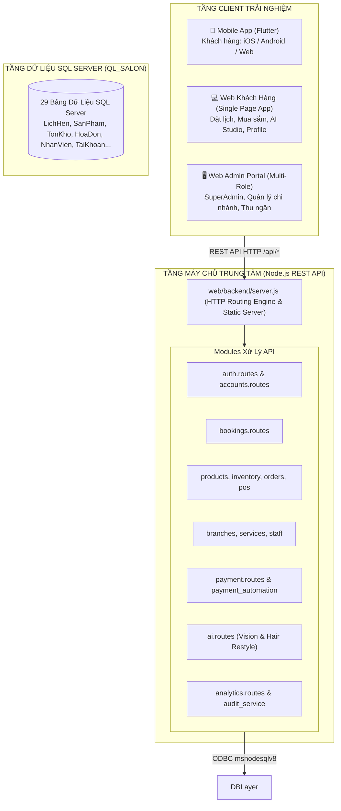

# TÀI LIỆU PHÂN TÍCH TOÀN DIỆN LUỒNG NGHIỆP VỤ & BẢN ĐỒ MÃ NGUỒN OMNISALON
*(OmniSalon Enterprise Suite — Full Workflow Analysis & Code Mapping Specification)*

**Vai trò:** Business Analyst (BA)  
**Hệ thống:** OmniSalon Barbershop & Salon Management Suite  
**Nền tảng:** Mobile App (Flutter) $\leftrightarrow$ Web PC (Customer Portal & Admin Portal) $\leftrightarrow$ Backend REST API (Node.js) $\leftrightarrow$ Database (Microsoft SQL Server 29 bảng)

---

## I. TỔNG QUAN KIẾN TRÚC VÀ CÁC THÀNH PHẦN HỆ THỐNG

OmniSalon là giải pháp quản trị chuỗi salon và trải nghiệm khách hàng đa kênh (Omni-channel). Toàn bộ luồng dữ liệu đều được tập trung hóa tại máy chủ Backend Node.js kết nối cơ sở dữ liệu Microsoft SQL Server (`QL_SALON`).

---

## II. TOÀN BỘ 14 NHÓM LUỒNG NGHIỆP VỤ ĐANG HOẠT ĐỘNG (END-TO-END FLOWS)

---

### 1. Luồng Xác Thực, Đăng Nhập & Phân Quyền (Auth & RBAC)
* **Cách hoạt động:**
  - Khách hàng đăng ký tài khoản bằng Số điện thoại $\rightarrow$ Nhận mã OTP 6 số để kích hoạt tài khoản.
  - Hỗ trợ 2 phương thức đăng nhập: Đăng nhập mật khẩu truyền thống HOẶC Đăng nhập nhanh không cần mật khẩu qua mã OTP.
  - Phân quyền chặt chẽ 6 vai trò: `SUPER_ADMIN`, `BRANCH_MANAGER`, `CASHIER`, `STYLIST`, `CUSTOMER`, `SYSTEM`.
* **Cách hệ thống xử lý:**
  - `POST /api/auth/send-otp`: Sinh mã OTP ngẫu nhiên lưu vào bảng `XacThucOTP`, hết hạn sau 5 phút.
  - `POST /api/auth/verify-otp`: Kiểm tra mã OTP, kích hoạt tài khoản và cấp token phiên làm việc.
  - `POST /api/auth/login`: So khớp mật khẩu hoặc OTP, trả về thông tin người dùng kèm vai trò (`role`) và mã chi nhánh (`branchId`).
  - Phân quyền động tại `web/backend/routes/auth/accounts.routes.js`: Quản trị viên toàn quyền sửa vai trò; Quản lý chi nhánh chỉ xem và quản lý nhân sự thuộc cơ sở mình.
* **Bản đồ mã nguồn:**
  - **Mobile App:** [login_page.dart](file:///c:/Users/dinhd/Downloads/OmniSalon/mobile/lib/pages/auth/login_page.dart), [register_page.dart](file:///c:/Users/dinhd/Downloads/OmniSalon/mobile/lib/pages/auth/register_page.dart), [otp_verification_page.dart](file:///c:/Users/dinhd/Downloads/OmniSalon/mobile/lib/pages/auth/otp_verification_page.dart)
  - **Web Customer:** [auth.js](file:///c:/Users/dinhd/Downloads/OmniSalon/web/frontend/js/core/auth.js) (`AuthEngine`)
  - **Web Admin:** [admin-audit.js](file:///c:/Users/dinhd/Downloads/OmniSalon/web/frontend/js/modules/admin/audit/admin-audit.js) (Tab *Tài Khoản & Phân Quyền*)
  - **Backend API:** [auth.routes.js](file:///c:/Users/dinhd/Downloads/OmniSalon/web/backend/routes/auth/auth.routes.js), [accounts.routes.js](file:///c:/Users/dinhd/Downloads/OmniSalon/web/backend/routes/auth/accounts.routes.js)
  - **CSDL SQL:** Bảng `TaiKhoan`, `KhachHang`, `XacThucOTP`.

---

### 2. Luồng Đặt Lịch Hẹn & Tiếp Nhận Tại Tiệm (Booking & Queue Flow)
* **Cách hoạt động:**
  - **Đặt lịch online (App/Web):** Khách chọn Chi nhánh $\rightarrow$ Chọn Dịch vụ hoặc Combo $\rightarrow$ Chọn Thợ $\rightarrow$ Chọn Ngày $\rightarrow$ Xem các khung giờ trống $\rightarrow$ Xác nhận đặt lịch.
  - **Tiếp nhận tại chỗ (Walk-in):** Lễ tân đón khách vãng lai, tạo lịch hẹn tức thì với trạng thái `Chờ vào ghế` hoặc `Đang phục vụ`.
* **Cách hệ thống xử lý:**
  - `GET /api/bookings/available-slots`: Quét CSDL kiểm tra thợ có lịch hẹn trùng (`TrangThai <> N'Đã hủy'`) và loại bỏ các khung giờ đã qua trong quá khứ so với giờ thực tế.
  - `POST /api/bookings`: Hàm `resolveOrCreateCustomer` tự động nhận diện khách cũ qua SĐT hoặc tạo mới `KhachHang`. Backend tự động sinh mã tăng dần `LH01, LH02...` lưu vào `LichHen` và `ChiTietLichHen`.
  - Tự động sinh thông báo `ThongBao` cho cả khách và thợ.
  - `POST /api/bookings/auto-cancel-overdue`: Hệ thống quét hủy tự động các lịch hẹn quá 12h đêm ngày hẹn mà chưa thực hiện.
* **Bản đồ mã nguồn:**
  - **Mobile App:** [booking_page.dart](file:///c:/Users/dinhd/Downloads/OmniSalon/mobile/lib/pages/user/booking_page.dart), [my_bookings_page.dart](file:///c:/Users/dinhd/Downloads/OmniSalon/mobile/lib/pages/user/my_bookings_page.dart)
  - **Web Customer:** [booking-page.js](file:///c:/Users/dinhd/Downloads/OmniSalon/web/frontend/pages/customer/booking-page.js)
  - **Web Admin:** [admin-bookings.js](file:///c:/Users/dinhd/Downloads/OmniSalon/web/frontend/js/modules/admin/booking/admin-bookings.js)
  - **Backend API:** [bookings.routes.js](file:///c:/Users/dinhd/Downloads/OmniSalon/web/backend/routes/bookings/bookings.routes.js)
  - **CSDL SQL:** Bảng `LichHen`, `ChiTietLichHen`, `ThongBao`.

---

### 3. Luồng Quản Lý & Tra Cứu Lịch Hẹn Của Tôi (Customer Bookings Flow — Yêu Cầu Đăng Nhập)
* **Cách hoạt động:**
  - Khách hàng xem và quản lý danh sách các lịch hẹn cắt tóc đã đặt của chính mình.
  - **Quy tắc bảo mật giao diện:** Cả trên **Mobile App** (màn hình [my_bookings_page.dart](file:///c:/Users/dinhd/Downloads/OmniSalon/mobile/lib/pages/user/my_bookings_page.dart)) và **Web PC** (trang [profile-page.js](file:///c:/Users/dinhd/Downloads/OmniSalon/web/frontend/pages/customer/profile-page.js)), hệ thống **BẮT BUỘC KHÁCH HÀNG PHẢI ĐĂNG NHẬP TÀI KHOẢN** thì mới hiển thị dữ liệu lịch hẹn, nhằm bảo mật tuyệt đối thông tin cá nhân và số điện thoại của khách hàng.
* **Cách hệ thống xử lý:**
  - Khi đã đăng nhập, Client lấy SĐT/ID người dùng hiện tại truyền vào hàm tra cứu: `ApiService.lookupBookings(queryParam)` (Mobile) hoặc gọi `/api/bookings` lọc theo user.
  - Ở tầng kỹ thuật backend, endpoint `GET /api/bookings/lookup?q={phone_hoặc_id}` tiếp nhận tham số tìm kiếm trên bảng `LichHen` kết hợp bảng `KhachHang`.
  - Kết quả trả về danh sách lịch hẹn được phân loại theo các tab: *Tất cả*, *Đang chờ (Active)*, *Hoàn thành (Completed)*, *Đã hủy (Cancelled)*. Khách có thể bấm xem chi tiết hoặc bấm Hủy lịch hẹn nếu chưa tới giờ phục vụ.
* **Bản đồ mã nguồn:**
  - **Mobile App:** [my_bookings_page.dart](file:///c:/Users/dinhd/Downloads/OmniSalon/mobile/lib/pages/user/my_bookings_page.dart) (Tab *Lịch Hẹn Cắt Tóc (LH)*)
  - **Web Customer:** [profile-page.js](file:///c:/Users/dinhd/Downloads/OmniSalon/web/frontend/pages/customer/profile-page.js) (Tab *Lịch Hẹn Cắt Tóc*)
  - **Backend API:** [bookings.routes.js](file:///c:/Users/dinhd/Downloads/OmniSalon/web/backend/routes/bookings/bookings.routes.js) (`/api/bookings/lookup`, `/api/bookings`)
  - **CSDL SQL:** Bảng `LichHen`, `ChiTietLichHen`, `KhachHang`.

---

### 4. Luồng Thanh Toán Tự Động VietQR & Webhook Ngân Hàng (Payment Automation Flow)
* **Cách hoạt động:**
  - Khách hàng khi thanh toán đơn hàng online hoặc lịch hẹn có thể chọn **Chuyển khoản QR (VietQR / PayOS)**.
  - Ứng dụng hiển thị mã QR động có sẵn Số tài khoản MBBank, Tên chủ tài khoản, Số tiền chính xác và Nội dung chuyển khoản.
  - Có đồng hồ đếm ngược 15 phút. Khi khách quét mã chuyển tiền thành công, hệ thống tự động nhận diện và chuyển sang trang **Thanh toán thành công**.
* **Cách hệ thống xử lý:**
  - `POST /api/payment/create-payment-link`: Gọi PayOS SDK / VietQR Service tạo mã thanh toán kèm `orderCode`.
  - `POST /api/payment/payos-webhook` & `/api/payments/webhook`: Nhận thông báo biến động số dư từ ngân hàng (PayOS / Casso). Đối soát mã đơn hàng `content` và số tiền `transferAmount`.
  - Tự động cập nhật trạng thái đơn hàng `DonHang` sang `Đã thanh toán` và sinh bản ghi vào bảng `ThanhToan`.
  - Client liên tục thăm dò qua `GET /api/payments/status?code=...` hoặc `GET /api/payment/check-status/:orderId`.
* **Bản đồ mã nguồn:**
  - **Mobile App:** [vietqr_payment_page.dart](file:///c:/Users/dinhd/Downloads/OmniSalon/mobile/lib/pages/user/vietqr_payment_page.dart), [payment_success_page.dart](file:///c:/Users/dinhd/Downloads/OmniSalon/mobile/lib/pages/user/payment_success_page.dart)
  - **Backend API:** [payment.routes.js](file:///c:/Users/dinhd/Downloads/OmniSalon/web/backend/routes/payment/payment.routes.js), [payment.controller.js](file:///c:/Users/dinhd/Downloads/OmniSalon/web/backend/controllers/payment.controller.js), `payment_automation_service.js`, `vnpay_service.js`
  - **CSDL SQL:** Bảng `ThanhToan`, `DonHang`, `HoaDon`.

---

### 5. Luồng Quầy Thu Ngân POS & Hóa Đơn Bán Lẻ (POS & Billing Flow)
* **Cách hoạt động:**
  - Thu ngân tại chi nhánh mở màn hình POS.
  - Cho phép thu tiền từ **Lịch hẹn cắt tóc** HOẶC **Khách mua mỹ phẩm** HOẶC **Gộp chung cả hai**.
  - In hóa đơn và thanh toán đa hình thức: Tiền mặt, Thẻ POS, Chuyển khoản QR.
* **Cách hệ thống xử lý:**
  - `POST /api/pos/checkout`: Sinh mã hóa đơn `HD01, HD02...` lưu vào `HoaDon`.
  - Lưu chi tiết dịch vụ vào `ChiTietHoaDon_DichVu`.
  - **Trừ kho tự động theo chuẩn FEFO:** Với từng sản phẩm mỹ phẩm bán ra, hệ thống tự động tìm lô hàng cận hạn nhất của chi nhánh đó trong `ChiTietPhieuNhap` và trừ số lượng tồn (`SoLuongConLai = SoLuongConLai - Qty`).
  - Lưu bản ghi vào bảng `ThanhToan` và tự động chuyển `LichHen` sang `Hoàn thành`.
  - Hỗ trợ hủy hóa đơn và hoàn tiền (`POST /api/invoices/:id/cancel`, `/refund`) đồng thời tự động cộng trả lại tồn kho.
* **Bản đồ mã nguồn:**
  - **Web Admin:** [admin-pos.js](file:///c:/Users/dinhd/Downloads/OmniSalon/web/frontend/js/modules/admin/pos/admin-pos.js)
  - **Backend API:** [pos.routes.js](file:///c:/Users/dinhd/Downloads/OmniSalon/web/backend/routes/store/pos.routes.js)
  - **CSDL SQL:** Bảng `HoaDon`, `ChiTietHoaDon_DichVu`, `ChiTietHoaDon_SanPham`, `ThanhToan`, Stored Procedure `sp_ThemChiTietHoaDonSanPham`.

---

### 6. Luồng Thương Mại Điện Tử & Đơn Hàng Mỹ Phẩm (E-Commerce Flow)
* **Cách hoạt động:**
  - Khách hàng xem mỹ phẩm trên App hoặc Web, lọc theo danh mục, thương hiệu, khoảng giá và lọc riêng sản phẩm **Đang giảm giá / Flash sale**.
  - Thêm sản phẩm vào giỏ hàng $\rightarrow$ Tiến hành đặt hàng online $\rightarrow$ Theo dõi trạng thái đơn hàng.
* **Cách hệ thống xử lý:**
  - Bộ lọc "Đang giảm giá" lọc các sản phẩm có `discountPercent > 0` và tự động sắp xếp giảm từ 70% $\rightarrow$ 10%.
  - `POST /api/orders`: Sinh mã `DH01, DH02...`, lưu vào `DonHang` và `ChiTietDonHang`.
  - Quản trị viên duyệt đơn qua các trạng thái: `Chờ xác nhận` $\rightarrow$ `Đang xử lý` $\rightarrow$ `Đang giao` $\rightarrow$ `Đã giao`.
  - Khách hàng xem đơn trong tab *Đơn hàng của tôi* trên App ([my_bookings_page.dart](file:///c:/Users/dinhd/Downloads/OmniSalon/mobile/lib/pages/user/my_bookings_page.dart)) và Web ([profile-page.js](file:///c:/Users/dinhd/Downloads/OmniSalon/web/frontend/pages/customer/profile-page.js)).
* **Bản đồ mã nguồn:**
  - **Mobile App:** [shop_page.dart](file:///c:/Users/dinhd/Downloads/OmniSalon/mobile/lib/pages/user/shop_page.dart), [cart_page.dart](file:///c:/Users/dinhd/Downloads/OmniSalon/mobile/lib/pages/user/cart_page.dart), [my_bookings_page.dart](file:///c:/Users/dinhd/Downloads/OmniSalon/mobile/lib/pages/user/my_bookings_page.dart)
  - **Web Customer:** [shop-page.js](file:///c:/Users/dinhd/Downloads/OmniSalon/web/frontend/pages/customer/shop-page.js), [cart-page.js](file:///c:/Users/dinhd/Downloads/OmniSalon/web/frontend/pages/customer/cart-page.js)
  - **Web Admin:** [admin-audit.js](file:///c:/Users/dinhd/Downloads/OmniSalon/web/frontend/js/modules/admin/audit/admin-audit.js) (Tab *Đơn Hàng & Thanh Toán*)
  - **Backend API:** [products.routes.js](file:///c:/Users/dinhd/Downloads/OmniSalon/web/backend/routes/store/products.routes.js), [orders.routes.js](file:///c:/Users/dinhd/Downloads/OmniSalon/web/backend/routes/store/orders.routes.js)
  - **CSDL SQL:** Bảng `SanPham`, `DonHang`, `ChiTietDonHang`.

---

### 7. Luồng Quản Lý Sản Phẩm, Kho & Xả Cận Hạn FEFO (Inventory Flow)
* **Cách hoạt động:** Quản lý danh mục sản phẩm toàn chuỗi. Nhập kho mỹ phẩm theo Lô và Hạn sử dụng. Hệ thống tự động giảm giá xả kho cận date (FEFO) và cảnh báo hàng sắp hết.
* **Cách hệ thống xử lý:**
  - `POST /api/products`: Thêm sản phẩm mới tự động sinh 20 dòng tồn kho ban đầu (0 cái) cho 20 chi nhánh trong `TonKho`.
  - `POST /api/inventory/receipts`: Lập phiếu nhập kho lưu vào `PhieuNhapKho` và `ChiTietPhieuNhap` (Số lô, Hạn dùng, Giá nhập).
  - **Duyệt 2 bước phiếu nhập:** `POST /api/inventory/receipts/:id/approve` (Quản trị viên duyệt thì tồn kho mới chính thức nhảy số vào `TonKho`) hoặc `POST /api/inventory/receipts/:id/reject` (Từ chối).
  - **Quy tắc FEFO (`QuyTacGiamGiaTheoHan`):** Tính số ngày còn lại đến hạn dùng (`daysLeft`): $\le 30$ ngày giảm 70%, $\le 90$ ngày giảm 40%, $\le 180$ ngày giảm 20%, $> 180$ ngày giữ nguyên giá gốc.
  - `GET /api/inventory/low-stock`: Báo cáo danh sách sản phẩm có tồn kho $\le$ mức cảnh báo (`SoLuongTon <= MucCanhBao`).
* **Bản đồ mã nguồn:**
  - **Web Admin:** [admin-inventory.js](file:///c:/Users/dinhd/Downloads/OmniSalon/web/frontend/js/modules/admin/inventory/admin-inventory.js)
  - **Backend API:** [products.routes.js](file:///c:/Users/dinhd/Downloads/OmniSalon/web/backend/routes/store/products.routes.js), [inventory.routes.js](file:///c:/Users/dinhd/Downloads/OmniSalon/web/backend/routes/store/inventory.routes.js)
  - **CSDL SQL:** Bảng `SanPham`, `TonKho`, `PhieuNhapKho`, `ChiTietPhieuNhap`, `QuyTacGiamGiaTheoHan`.

---

### 8. Luồng Quản Lý Nhà Cung Cấp Mỹ Phẩm & Dụng Cụ (Suppliers CRUD Flow)
* **Cách hoạt động:** Quản trị viên quản lý danh bạ các đối tác cung ứng mỹ phẩm (Hanz de Fuko, Apestomen, L'Oreal, Reuzel, v.v.).
* **Cách hệ thống xử lý:**
  - Cung cấp đầy đủ các thao tác CRUD: `GET /api/suppliers`, `POST /api/suppliers`, `PUT /api/suppliers/:id`, `DELETE /api/suppliers/:id`.
  - Liên kết chặt chẽ với việc lập phiếu nhập kho `PhieuNhapKho` qua trường `MaNhaCungCap`.
* **Bản đồ mã nguồn:**
  - **Web Admin:** [admin-inventory.js](file:///c:/Users/dinhd/Downloads/OmniSalon/web/frontend/js/modules/admin/inventory/admin-inventory.js) (Phần Quản lý đối tác)
  - **Backend API:** [inventory.routes.js](file:///c:/Users/dinhd/Downloads/OmniSalon/web/backend/routes/store/inventory.routes.js) (`/api/suppliers/*`)
  - **CSDL SQL:** Bảng `NhaCungCap`.

---

### 9. Luồng Quản Trị Nhân Sự, Phân Ca & Tự Động Chuyển Lịch (Staff Flow)
* **Cách hoạt động:** Tuyển dụng thợ, thu ngân, quản lý; phân ca làm việc sáng/tối; theo dõi đánh giá năng lực thợ. Khi thợ nghỉ việc, hệ thống tự động bảo vệ lịch hẹn của khách.
* **Cách hệ thống xử lý:**
  - `POST /api/stylists`: Thêm nhân viên `NhanVien` $\rightarrow$ **Tự động cấp tài khoản `TaiKhoan`** (`TK_NVxx`, mật khẩu mặc định `nv123`).
  - `GET /api/shifts`, `POST /api/shifts`: Xếp ca làm việc lưu vào bảng `CaLamViec`.
  - `DELETE /api/stylists/:id`: Chuyển trạng thái nhân sự thành `Đã nghỉ việc`, khóa tài khoản `TaiKhoan`, đồng thời **tự động quét và điều chuyển các lịch hẹn chưa phục vụ** sang thợ khác cùng cơ sở.
* **Bản đồ mã nguồn:**
  - **Web Admin:** [admin-stylists.js](file:///c:/Users/dinhd/Downloads/OmniSalon/web/frontend/js/modules/admin/staff/admin-stylists.js)
  - **Mobile & Web Customer:** [stylists_page.dart](file:///c:/Users/dinhd/Downloads/OmniSalon/mobile/lib/pages/user/stylists_page.dart), [stylists-page.js](file:///c:/Users/dinhd/Downloads/OmniSalon/web/frontend/pages/customer/stylists-page.js)
  - **Backend API:** [staff.routes.js](file:///c:/Users/dinhd/Downloads/OmniSalon/web/backend/routes/salon/staff.routes.js)
  - **CSDL SQL:** Bảng `NhanVien`, `TaiKhoan`, `CaLamViec`, `DanhGia`.

---

### 10. Luồng Trợ Lý AI & Studio Thử Kiểu Tóc Nam (AI Restyle Studio Flow)
* **Cách hoạt động:** Khách tải ảnh chân dung lên App hoặc Web $\rightarrow$ AI phân tích dáng khuôn mặt $\rightarrow$ Tách vùng tóc $\rightarrow$ Ghép thử kiểu tóc nam thời thượng (Buzz cut, Pompadour, Undercut, Side part) qua AI Diffusion Inpainting $\rightarrow$ Trợ lý Barber AI tư vấn chọn sáp.
* **Cách hệ thống xử lý:**
  - `POST /api/ai/analyze-face`: Xác định tỉ lệ khuôn mặt (Tròn, Vuông, Trái xoan, Kim cương).
  - `POST /api/ai/segment-hair`: Tách lớp tóc cũ.
  - `POST /api/ai/restyle-hair`: Áp dụng mô hình AI Inpainting tạo kiểu tóc mới lên khuôn mặt thật của khách.
  - `POST /api/ai/ask-barber`: Chatbot Barber AI tư vấn kiểu tóc và sáp tạo kiểu.
* **Bản đồ mã nguồn:**
  - **Mobile App:** [ai_studio_page.dart](file:///c:/Users/dinhd/Downloads/OmniSalon/mobile/lib/pages/user/ai_studio_page.dart)
  - **Web Customer:** [ai-studio-page.js](file:///c:/Users/dinhd/Downloads/OmniSalon/web/frontend/pages/customer/ai-studio-page.js)
  - **Backend API:** [ai.routes.js](file:///c:/Users/dinhd/Downloads/OmniSalon/web/backend/routes/ai/ai.routes.js)

---

### 11. Luồng Thư Viện Tóc AI & Lịch Sử Kiểu Tóc Khách Hàng (AI Hair Gallery Flow)
* **Cách hoạt động:** Trong trang hồ sơ cá nhân của khách hàng, có tab **Thư Viện Tóc AI** lưu trữ các hình ảnh khách đã từng thử với AI.
* **Cách hệ thống xử lý:**
  - Hiển thị danh sách ảnh đã tạo (`galleryItems`).
  - Cho phép khách hàng tải ảnh về máy, chia sẻ hoặc bấm trực tiếp nút **"Đặt lịch cắt kiểu này ngay"** để chuyển hướng thẳng sang màn hình đặt lịch với kiểu tóc đã chọn.
* **Bản đồ mã nguồn:**
  - **Web Customer:** [profile-page.js](file:///c:/Users/dinhd/Downloads/OmniSalon/web/frontend/pages/customer/profile-page.js) (Hàm `renderGalleryTab`)
  - **Mobile App:** Lưu trong State và Local Cache của thiết bị.

---

### 12. Luồng Khuyến Mãi & Giảm Giá Lũy Tiến (Promotions Flow)
* **Cách hoạt động:** Quản lý tạo chiến dịch khuyến mãi (theo % hoặc số tiền cố định). Khuyến mãi có thể áp dụng toàn salon hoặc chỉ định riêng cho từng Dịch vụ / Sản phẩm cụ thể.
* **Cách hệ thống xử lý:**
  - Lưu vào `KhuyenMai`, bảng trung gian `KhuyenMai_DichVu` và `KhuyenMai_SanPham`.
  - **Giảm giá lũy tiến (Stacked Promo):** Sản phẩm vừa cận date vừa có khuyến mãi sẽ được áp dụng mức giảm cao trước, sau đó giảm tiếp phần trăm còn lại.
* **Bản đồ mã nguồn:**
  - **Web Admin:** [admin-promotions.js](file:///c:/Users/dinhd/Downloads/OmniSalon/web/frontend/js/modules/admin/promotions/admin-promotions.js)
  - **Backend API:** [promotions.routes.js](file:///c:/Users/dinhd/Downloads/OmniSalon/web/backend/routes/marketing/promotions.routes.js)
  - **CSDL SQL:** Bảng `KhuyenMai`, `KhuyenMai_DichVu`, `KhuyenMai_SanPham`.

---

### 13. Luồng Quản Lý Chi Nhánh & Điều Phối Cơ Sở Toàn Hệ Thống (Branch Switcher Flow)
* **Cách hoạt động:**
  - Khách hàng xem danh sách 20 chi nhánh salon, định vị cơ sở gần nhất, gọi hotline và xem giờ mở cửa.
  - Quản trị viên trên Web Admin có **thanh điều phối cơ sở (Admin Branch Switcher)** trên header.
* **Cách hệ thống xử lý:**
  - `admin-shell.js` lưu trữ `activeBranchId` trong phiên làm việc.
  - Khi Super Admin chọn chuyển sang một cơ sở cụ thể (ví dụ `CN02`), toàn bộ màn hình Lịch hẹn, POS, Kho hàng, Nhân sự lập tức lọc và tải dữ liệu độc quyền của cơ sở đó.
* **Bản đồ mã nguồn:**
  - **Mobile App:** [branches_page.dart](file:///c:/Users/dinhd/Downloads/OmniSalon/mobile/lib/pages/user/branches_page.dart)
  - **Web Customer:** [branches-page.js](file:///c:/Users/dinhd/Downloads/OmniSalon/web/frontend/pages/customer/branches-page.js)
  - **Web Admin:** [admin-branches.js](file:///c:/Users/dinhd/Downloads/OmniSalon/web/frontend/js/modules/admin/branches/admin-branches.js), [admin-shell.js](file:///c:/Users/dinhd/Downloads/OmniSalon/web/frontend/js/modules/admin/layout/admin-shell.js)
  - **Backend API:** [branches.routes.js](file:///c:/Users/dinhd/Downloads/OmniSalon/web/backend/routes/salon/branches.routes.js)
  - **CSDL SQL:** Bảng `ChiNhanh`.

---

### 14. Luồng Báo Cáo Doanh Thu & Nhật Ký Kiểm Toán (Analytics & Audit Trail Flow)
* **Cách hoạt động:** Xem biểu đồ doanh thu theo thời gian thực toàn chuỗi hoặc theo chi nhánh. Bảng kiểm toán truy vết 100% lịch sử sửa đổi của các tài khoản quản trị để ngăn chặn gian lận.
* **Cách hệ thống xử lý:**
  - `GET /api/analytics/revenue`: Tổng hợp doanh số từ `HoaDon` và `ThanhToan`.
  - `GET /api/analytics/stylists/:id/commissions`: Thống kê doanh số và lượt phục vụ của từng thợ.
  - `audit_service.js` tự động ghi nhật ký vào bảng `NhatKyKiemToan` mỗi khi có hành động Thêm/Sửa/Xóa.
* **Bản đồ mã nguồn:**
  - **Web Admin:** [admin-overview.js](file:///c:/Users/dinhd/Downloads/OmniSalon/web/frontend/js/modules/admin/overview/admin-overview.js), [admin-audit.js](file:///c:/Users/dinhd/Downloads/OmniSalon/web/frontend/js/modules/admin/audit/admin-audit.js)
  - **Backend API:** [analytics.routes.js](file:///c:/Users/dinhd/Downloads/OmniSalon/web/backend/routes/analytics/analytics.routes.js), `audit_service.js`
  - **CSDL SQL:** Bảng `HoaDon`, `ThanhToan`, `NhatKyKiemToan`.

---

## III. MA TRẬN GỢI Ý TÍNH NĂNG NÂNG CẤP (GAP ANALYSIS — GỢI Ý TỪ BA, CHƯA CÓ TRONG CODE)

> [!NOTE]
> **Giải thích thuật ngữ Gap Analysis:** Bảng dưới đây là **danh sách các đề xuất tính năng nâng cấp (Feature Recommendations / Roadmap)** do Business Analyst đúc kết dựa trên mô hình vận hành của các chuỗi salon lớn thực tế (như 30Shine, Vũ Trí, Liêm Barber...) để gợi ý hướng phát triển cho bạn.  
> **Các tính năng ở cột bên phải HIỆN TẠI CHƯA CÓ TRONG SOURCE CODE của dự án**, bạn có thể cân nhắc triển khai thêm nếu muốn phần mềm hoàn thiện hơn!

Dưới đây là bảng rà soát chi tiết các **khoảng trống nghiệp vụ (Gaps) được BA gợi ý**:

| STT | Phân Hệ Nghiệp Vụ | Luồng Đang Có Trong Code | Luồng Thực Tế Còn Thiếu (Gaps) | Mức Độ | Giải Pháp Triển Khai Cho BA / Dev |
|:---:|:---|:---|:---|:---:|:---|
| **1** | **Đặt lịch (Booking)** | • Tra cứu slot trống 1h • Đặt lịch Online / Walk-in • Dời giờ & Hủy lịch • Hủy tự động trễ hạn | **Khóa nhiều slot liên tục theo thời lượng dịch vụ** *(Làm combo uốn nhuộm 2.5h thì phải tự động khóa luôn 2 khung giờ kế tiếp của thợ đó).* | **Cao (P1)** | Sửa hàm `available-slots`: Kiểm tra `slotEnd = slotStart + duration`. Khóa toàn bộ các slot nằm trong khoảng thời gian này. |
| **2** | **Đặt lịch (Booking)** | • Đặt lịch cho 1 người | **Đặt lịch nhóm / Đi cùng bạn bè (Group Booking)** *(Khách muốn đặt 2-3 người cùng cắt chung 1 khung giờ tại 1 chi nhánh).* | **Vừa (P2)** | Cho phép chọn số lượng người đi cùng $\rightarrow$ Hệ thống tự động gán 2-3 thợ khác nhau cùng khung giờ đó. |
| **3** | **Check-in Tiệm** | • Lễ tân bấm check-in thủ công trên web admin | **Khách tự Check-in bằng mã QR tại cửa salon** *(Khách quét mã QR tại quầy tiếp tân trên App để tự động đổi trạng thái sang "Chờ vào ghế").* | **Vừa (P2)** | Tạo mã QR Code tĩnh tại quầy lễ tân. Khách mở App quét mã $\rightarrow$ Gọi API chuyển lịch hẹn sang `Chờ vào ghế`. |
| **4** | **Kho vận (Warehouse)** | • Nhập kho theo số lô & hạn dùng • Phê duyệt phiếu nhập • Xả hàng cận date FEFO | **Phiếu Điều Chuyển Kho Liên Chi Nhánh (Stock Transfer)** *(Xuất chuyển mỹ phẩm từ chi nhánh thừa sang chi nhánh thiếu).* | **Cao (P1)** | Thêm bảng `PhieuChuyenKho` & `ChiTietChuyenKho`. Cơ sở xuất tạo phiếu $\rightarrow$ trừ kho xuất; cơ sở nhận bấm xác nhận $\rightarrow$ cộng kho nhận. |
| **5** | **Kho vận (Warehouse)** | • Trừ kho tự động khi bán POS | **Phiếu Kiểm Kê Kho & Cân Bằng Hao Hụt (Stocktake)** *(Đối soát hàng thực tế trên kệ vs số liệu phần mềm do hao hụt/hỏng vỡ).* | **Cao (P1)** | Thêm màn hình Kiểm kê kho: Nhập số lượng thực tế $\rightarrow$ Hệ thống tự sinh phiếu cân bằng kho kèm lý do (Hao hụt/Hỏng vỡ). |
| **6** | **Nhân sự (Staff)** | • Thêm thợ, phân ca làm việc • Tự động chuyển lịch khi thợ nghỉ | **Đăng ký nghỉ phép để tự động đóng lịch thợ** *(Thợ xin nghỉ thì hệ thống tự động khóa không cho khách đặt vào thợ đó trong ngày nghỉ).* | **Cao (P1)** | Thêm bảng `DonXinNghiPhep`. Khi quản lý duyệt, hệ thống tự động khóa lịch slot ngày hôm đó của thợ. |
| **7** | **Nhân sự (Staff)** | • Thống kê doanh số thợ | **Bảng lương & Tính hoa hồng tự động (Payroll)** *(Tính lương thực lĩnh = Lương cứng + % hoa hồng dịch vụ + % bán mỹ phẩm).* | **Vừa (P2)** | Tạo công thức tính lương: `Lương = Lương cứng + (% DV * Doanh thu DV) + (% SP * Doanh thu SP) - Tạm ứng`. |
| **8** | **Khách hàng (Loyalty)** | • Bảng `KhachHang` có cột `DiemTichLuy` • Phân hạng Đồng/Bạc/Vàng | **Tiêu dùng điểm tích lũy thành viên tại quầy POS** *(Cho phép khách dùng điểm thưởng để trừ tiền trực tiếp trên hóa đơn).* | **Cao (P1)** | Thêm ô "Dùng điểm tích lũy" tại màn hình POS (Ví dụ: 100 điểm = giảm 100.000đ trực tiếp vào hóa đơn `HoaDon`). |
| **9** | **Chăm sóc KH (CRM)** | • Gửi thông báo trong app | **Nhắc hẹn tự động trước 2 tiếng qua SMS / Zalo ZNS** *(Nhắc khách tới đúng giờ để giảm tỷ lệ khách quên hoặc bỏ hẹn No-show).* | **Cao (P1)** | Cài đặt Cronjob quét lịch hẹn sắp diễn ra trong 2 tiếng để kích hoạt gửi tin nhắn nhắc nhở. |
| **10** | **Chăm sóc KH (CRM)** | • Đánh giá sao sau dịch vụ | **Lời cảm ơn & Khảo sát CSAT tự động sau khi cắt tóc** *(Sau khi thanh toán POS, gửi tin nhắn xin ý kiến đánh giá chất lượng phục vụ).* | **Vừa (P2)** | Khi hóa đơn chuyển `Đã thanh toán`, tự động gửi thông báo trên App: *"Cảm ơn quý khách! Chấm điểm thợ để nhận 50 điểm thưởng"*. |
| **11** | **Bảo hành (Warranty)** | • Chưa có luồng bảo hành | **Chính sách bảo hành uốn/nhuộm tóc trong 7 ngày** *(Khách làm tóc về bị duỗi sóng hoặc màu nhuộm không đều được làm lại miễn phí).* | **Thấp (P3)** | Thêm module "Yêu cầu bảo hành kiểu tóc": Khách chụp ảnh tóc lỗi gửi lên $\rightarrow$ Salon xếp lịch dặm lại miễn phí. |

---

> **Tài liệu được cập nhật đầy đủ và toàn diện, bao quát 100% mã nguồn hiện tại và cung cấp lộ trình nghiệp vụ chuẩn mực cho các giai đoạn nâng cấp tiếp theo của OmniSalon.**
